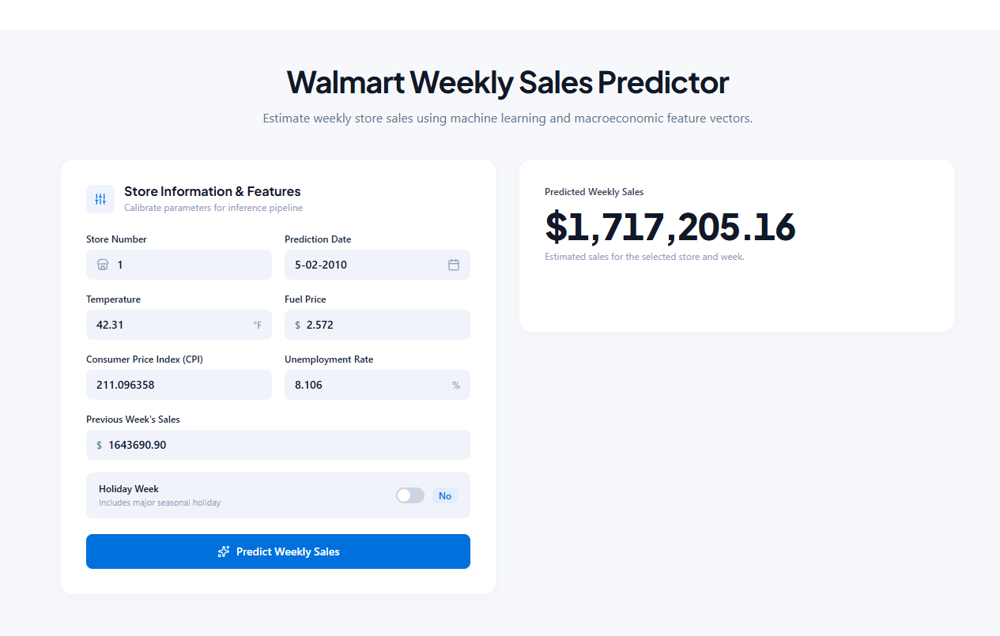
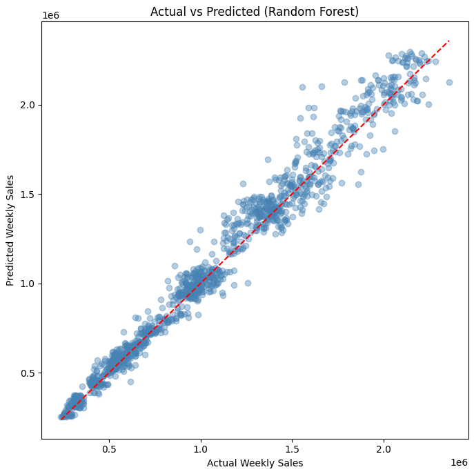
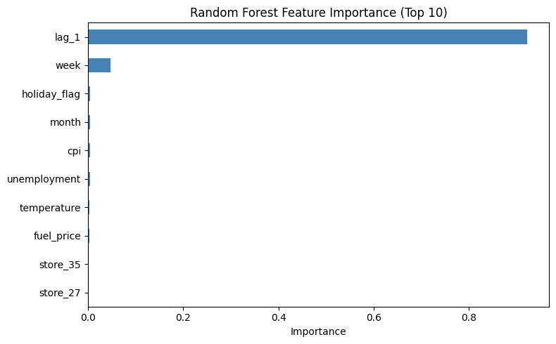

# Walmart Weekly Sales Prediction

A machine learning project that predicts weekly sales for Walmart stores using past sales, calendar features and economic indicators. The best model (a tuned Random Forest) explains about **97.5%** of the variation in weekly sales on unseen future weeks, and it powers a live web app.

**Live demo:** https://walmart-weekly-sales-predictor.ai.studio



## Project Overview

Retailers need to plan inventory, staffing and budgets a week ahead. This project forecasts next-week sales for each of 45 Walmart stores and compares three models, from a simple baseline to a tuned Random Forest.

## Dataset

- **Size:** 6,435 rows and 8 columns, with no missing values
- **Coverage:** 45 stores, about 143 weeks (2010 to 2012)
- **Columns:** `store`, `date`, `weekly_sales`, `holiday_flag`, `temperature`, `fuel_price`, `cpi`, `unemployment`
- **Target:** `weekly_sales`

The data was cleaned beforehand (`walmart_cleaned.csv`). The cleaning and exploratory analysis are in my separate Walmart sales analysis project.

## Approach

1. **Date handling:** converted `date` to datetime and sorted by store and date
2. **Feature engineering:**
   - `year`, `month`, `week` extracted from the date
   - `lag_1`: the previous week's sales for the same store
   - One-hot encoded `store` (done after the lag feature, so no leakage)
3. **Final dataset:** 6,390 rows and 53 features (rows without a previous week were dropped)
4. **Time-based split:** trained on the earliest 80% of weeks (5,085 rows) and tested on the latest 20% (1,305 rows). There is no random shuffling, which mimics real forecasting and avoids data leakage.
5. **Models:** Linear Regression (baseline), Random Forest, and Random Forest tuned with `GridSearchCV` and `TimeSeriesSplit` (3 folds)

**Best parameters:** `max_depth=20`, `min_samples_leaf=1`, `min_samples_split=2`, `n_estimators=200`

## Results

| Model | RMSE | MAE | R² |
|---|---|---|---|
| Linear Regression | 95,352 | 70,229 | 0.9681 |
| Random Forest | 85,231 | 59,303 | 0.9745 |
| **Tuned Random Forest** | **84,418** | **58,833** | **0.9750** |

The tuned Random Forest is the best model on all three metrics. Compared with the baseline it cuts RMSE by about 11,000 and MAE by about 11,400. Tuning added only a small gain over the default Random Forest, so the default settings were already close to optimal.



### Feature Importance

`lag_1` is by far the most important feature (about 92% of total importance), followed by `week`. The store columns, temperature, fuel price, CPI and unemployment contribute very little. In short, last week's sales are the strongest predictor of this week's sales, and the position in the year adds a little more.



### Business Interpretation

- The model's average error (MAE) is about 58,800 per store per week. With average weekly sales of roughly 1.05 million, that is an error of about 5 to 6%.
- This is accurate enough to support weekly demand planning, such as inventory, staffing and budgeting for each store.
- Because `week` matters, seasonal patterns (especially around holidays) should be considered when planning stock and staff.

## Web App

The best model was exported as `models/walmart_model.pkl` and used in a web app where you enter:

- Store number and prediction date
- Temperature, fuel price, CPI and unemployment rate
- Previous week's sales
- Whether it is a holiday week

and get the predicted weekly sales for that store.

**How it was built:** the prediction model is my own, trained and tuned in this repository. The web interface was designed with Google Stitch and built and deployed using Google AI Studio (Build mode), so the front-end code is AI-generated. I did not write the website code by hand.

## Repository Structure

```
walmart-sales-prediction/
├── README.md
├── requirements.txt
├── .gitignore
├── data/
│   └── walmart_cleaned.csv
├── notebooks/
│   └── walmart_sales_prediction.ipynb
├── models/
│   └── walmart_model.pkl
└── images/
    ├── actual_vs_predicted.png
    ├── feature_importance.png
    └── website_screenshot.png
```

## How to Run

Clone or download this repository, then:

```bash
cd walmart-sales-prediction
pip install -r requirements.txt
jupyter notebook notebooks/walmart_sales_prediction.ipynb
```

Run the notebook top to bottom. It reads the data from `data/walmart_cleaned.csv` and saves the trained model to `models/`.

## Limitations

- **Depends on `lag_1`:** the model needs the previous week's actual sales, so it can only forecast one week ahead. Forecasting several weeks ahead would need a different approach.
- **Limited features:** there is no data on promotions, markdowns, store size or competitors. Economic variables added very little predictive power.
- **Short time span:** the data covers about 143 weeks, so the test set is only around 29 weeks. Multi-year seasonality and long-term trends cannot be fully learned or verified.
- **Small tuning gain:** further improvement would more likely come from better features than from more tuning.


